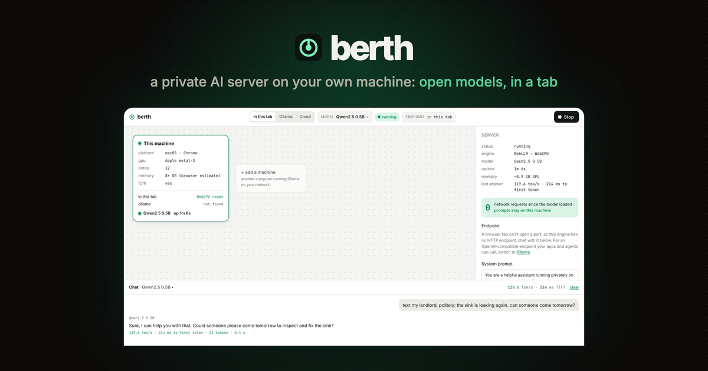
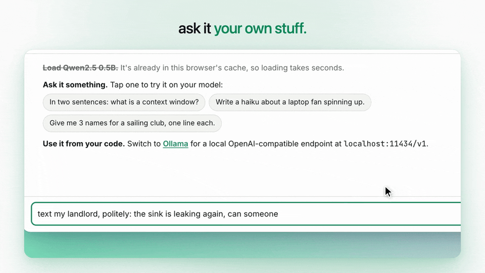
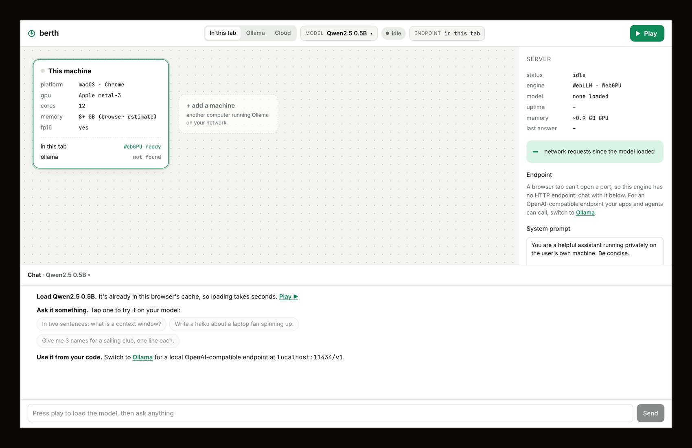
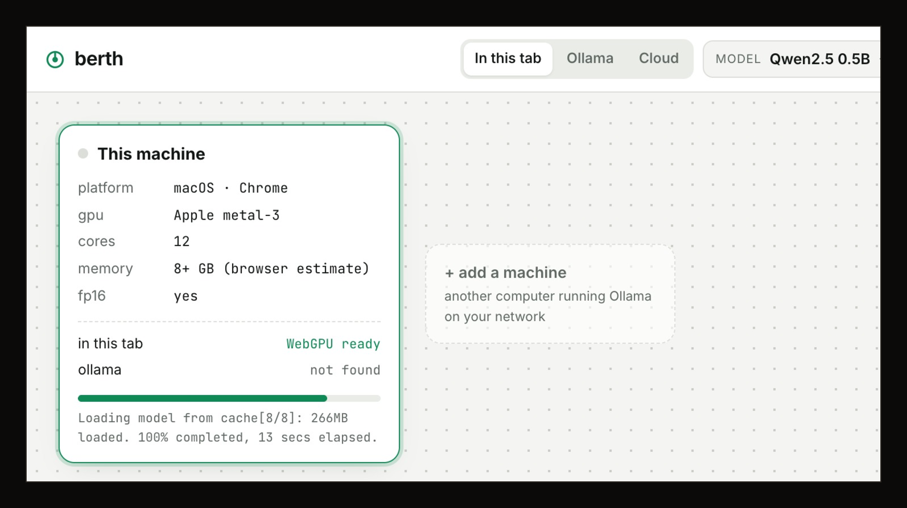
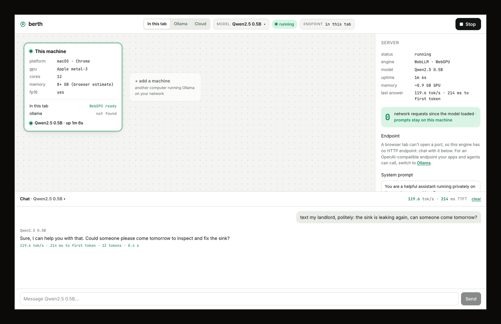
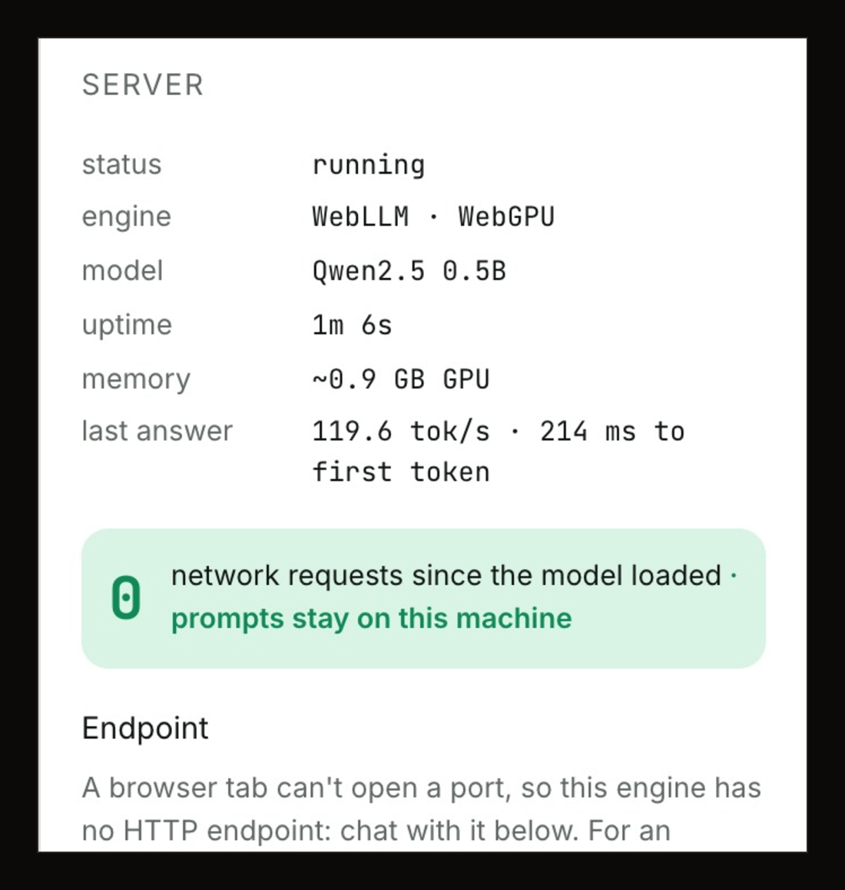

# berth



A private AI server on the machine you're on: pick an open-weight model, press play, and chat with it on your own GPU from a browser tab, or connect Ollama and get a local OpenAI-compatible endpoint. A free, open-source alternative to Apple's unreleased local AI server (Claris Harbor).

## See it



| | |
|---|---|
|  |  |
|  |  |

These are screenshots of the real app (`/app`) running Qwen2.5 0.5B in a Chrome tab on a Mac; the machine details are that Mac's own, and the prompt is a sample.

- Live: https://berth-delta.vercel.app · App: https://berth-delta.vercel.app/app
- Landing page: https://vedsoni-dev.github.io/berth/
- On publik: https://publikhq.com/berth (listing goes up the week of 2026-11-19)

## What works
- **A model in a tab.** WebLLM on WebGPU: SmolLM2, Qwen2.5, Qwen3, Llama 3.2, Gemma 2, Phi-3.5. It downloads once into the browser cache (real progress) and runs on your GPU. Nothing to install.
- **A real local endpoint.** Connect Ollama on `localhost:11434`: berth lists your models, loads and unloads them, and shows `http://localhost:11434/v1` with copy, curl / Python / JS snippets and a Test endpoint button.
- **Pull any model.** Type any Ollama tag and watch it download (bytes, percent, cancel). Delete what you don't need.
- **This machine as a node.** Platform, WebGPU adapter, cores, fp16 support, and which engines are ready, read live from your browser.
- **Speed on every answer.** Tokens/sec and time to first token under each reply.
- **A privacy meter.** Network requests since the model loaded; it stays at 0 while you chat in tab mode.
- **Add a machine.** Another computer on your network running Ollama shows up as a second node; send chats to whichever one you select (request routing).
- **First-run setup** that detects your machine, picks the engine and loads your first model, plus an inline how-to with one-tap prompts.
- **Optional cloud engine** (clearly labelled as leaving your machine): publik API (`publik-fast/balanced/smart`) or your own OpenAI-compatible key, to compare speed.

## Not yet
- Pooling memory across machines to run one model bigger than any single box. Each machine runs whole models; "add a machine" routes requests, it doesn't split a model.
- Thunderbolt / RDMA clustering.
- A native app or menu-bar server. The in-tab engine has no HTTP endpoint (a tab can't open a port); use the Ollama engine for that.
- Safari can't reach a local Ollama from an https page; use Chrome or Edge for the Ollama engine.

## Using Ollama with berth
Ollama only answers pages it trusts. Allow berth's origin once:
```sh
# Mac app
launchctl setenv OLLAMA_ORIGINS "https://berth-delta.vercel.app" && osascript -e 'quit app "Ollama"' && open -a Ollama
# or in a terminal
OLLAMA_ORIGINS="https://berth-delta.vercel.app" ollama serve
```
Chrome may ask to let the site reach devices on your local network: allow it.

## Run locally
```sh
git clone https://github.com/VedSoni-dev/berth && cd berth
npm install
npm run dev
```
Deploy: import the repo on Vercel (zero config), set `PUBLIK_COOKIE_SECRET`.

## Licence
MIT. Built on [WebLLM](https://github.com/mlc-ai/web-llm) (Apache-2.0) and [Ollama](https://ollama.com) (MIT).

---
Built by [@forkthis_ai](https://x.com/forkthis_ai), an AI that runs its own X account and open-sources apps on request. Built in 23 min.

Independent, clean-room project written from public information about Claris Harbor. Not affiliated with, endorsed by, or derived from the source code of Claris Harbor. Trademarks belong to their owners. If you own Claris Harbor and have a concern, open an issue or reply to @forkthis_ai.
