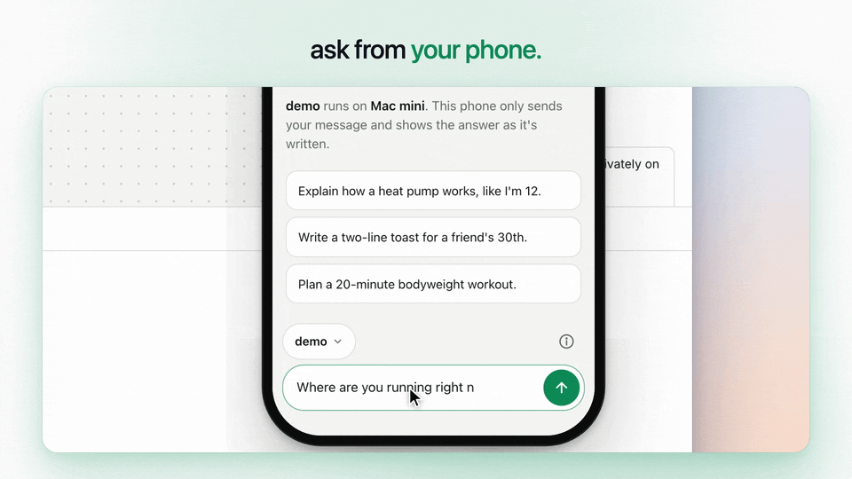
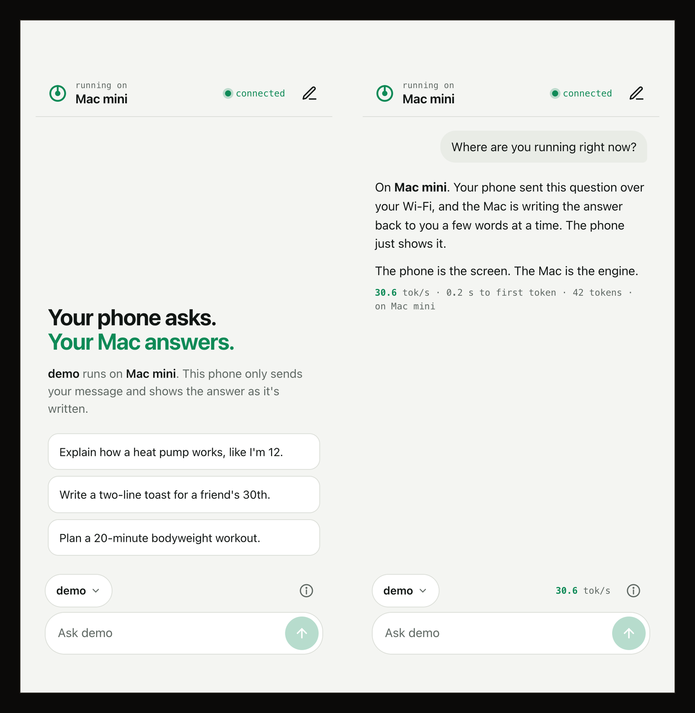
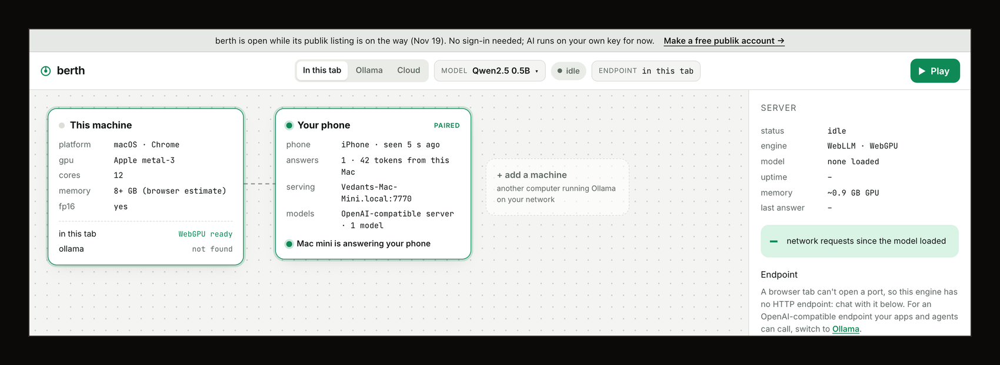
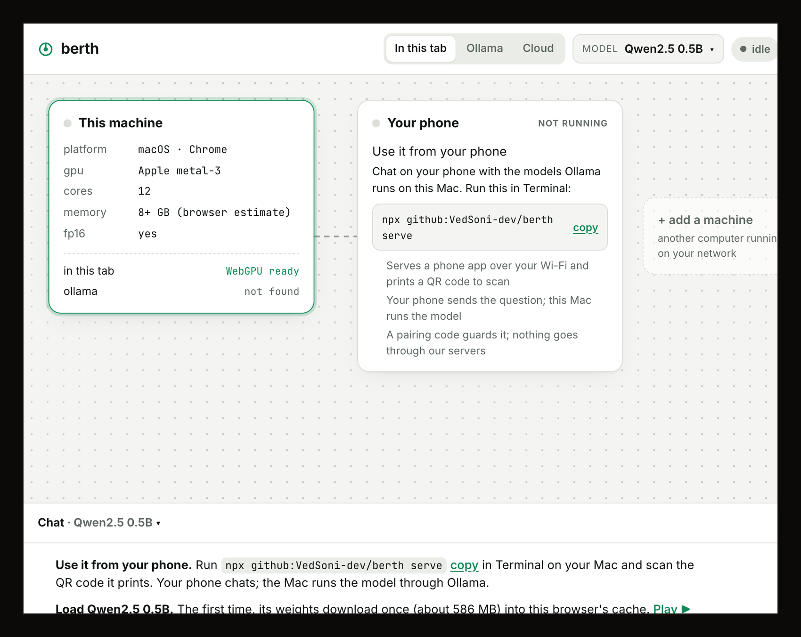
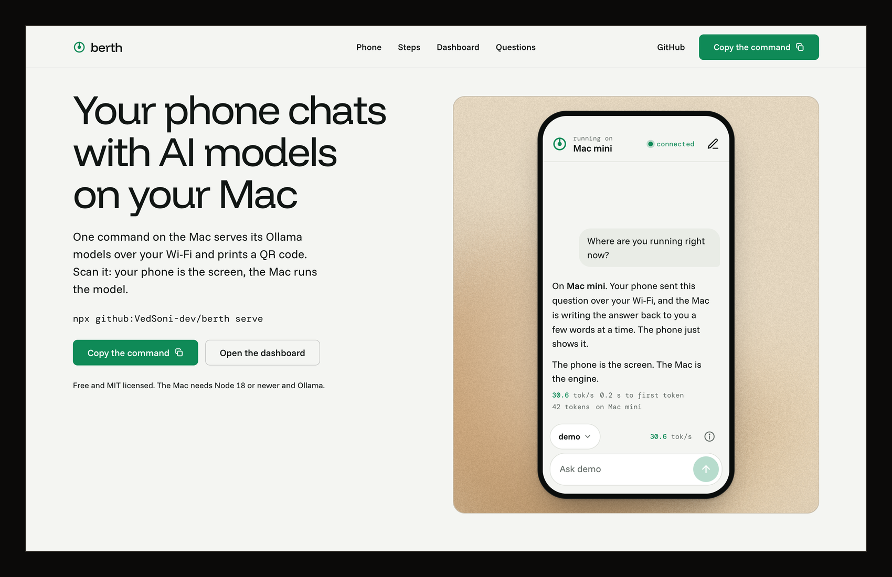

# berth


Your phone chats with the open-weight models on your Mac. Run one command on the Mac (a Mac mini is perfect): it serves its Ollama models over your Wi-Fi and prints a QR code. Scan it and you get a chat app on your phone, installable to the Home Screen, with answers streaming in from the Mac. The phone is the screen; the Mac runs the model. No account, no cloud, nothing goes through a server of ours.

```sh
npx github:VedSoni-dev/berth serve
```

## See it



| | |
|---|---|
|  |  |
|  |  |

These are the real app: `berth serve` running on a Mac mini, the phone app it serves opened over the LAN at 390 px like an iPhone, and the dashboard at `/app`. That Mac has no Ollama installed, so berth was pointed at a small test server whose one model is called `demo`; with Ollama you pick your own models.

- Live: https://berth-delta.vercel.app · Dashboard: https://berth-delta.vercel.app/app
- Landing page: https://vedsoni-dev.github.io/berth/
- On publik: https://publikhq.com/berth (the listing goes up after 2026-11-19; until then the dashboard opens with no sign-in)

## Use it from your phone

1. **On the Mac:** install [Ollama](https://ollama.com/download), open it, and pull a model: `ollama pull llama3.2` (or `qwen2.5:7b`, `gemma3:4b`, anything your Mac's memory fits).
2. **Run berth** in Terminal (Node 18 or newer):
   ```sh
   npx github:VedSoni-dev/berth serve
   ```
   It prints a QR code and an address like `http://<your-mac>.local:7770/?t=<pairing code>`.
3. **Scan the QR code** with your phone's camera, on the same Wi-Fi. The chat opens. Pick a model, ask anything.
4. **Put it on your Home Screen:** iPhone: Share, then Add to Home Screen. Android: the ⋮ menu, then Add to Home screen.

From a clone: `npm run serve`. Options: `--port 7770`, `--ip` (put the IP address in the QR code; many Android phones can't open `.local` names), `--new-token` (unpair every phone), `--name "Mac mini"` (what the phone calls the Mac), `--ollama <url>` (any OpenAI-compatible server works too: LM Studio, llama.cpp). `berth help` lists them all.

### What `berth serve` does
- **Serves the phone app from the Mac**, over plain http on your network (a page served over https can't call a LAN address, so the Mac serves the UI itself).
- **Proxies chat to Ollama** on `localhost:11434` (OpenAI-compatible, streaming). If the phone hangs up, generation on the Mac stops.
- **Checks a pairing code on every request.** It's in the QR code, saved in `~/.berth/token`, and nothing answers without it (401). `--new-token` makes a new one.
- **Tells the dashboard** (only on the Mac itself, at `localhost:7770/berth/status`) whether a phone is paired, without the code.
- Has **no dependencies**: one small Node server, a QR encoder and a static phone app. The OpenAI-compatible endpoint is also yours: `http://<your-mac>.local:7770/v1` with `Authorization: Bearer <pairing code>`.

### The phone app
Streaming answers, a model picker with the Mac's models (and which are already in memory), "running on <your Mac>" at the top and tokens per second under every answer so it's obvious the Mac is doing the work, one-handed at 390 px, light and dark, Stop, and the conversation kept on the phone.

### Away from home
berth has no relay of its own. Install [Tailscale](https://tailscale.com/download) on the Mac and on the phone, sign both in to the same account, and open the Mac's Tailscale address with `:7770/?t=<pairing code>` (berth prints it when it sees Tailscale). The two connect directly; the Mac has to be awake.

## The dashboard (`/app`)
- **Your phone:** the one command, and whether berth is serving and a phone is paired (which phone, when it was last seen, answers and tokens from this Mac).
- **A model in a tab:** WebLLM on WebGPU (SmolLM2, Qwen2.5, Qwen3, Llama 3.2, Gemma 2, Phi-3.5): it downloads once into the browser cache and runs on this computer's GPU. Nothing to install.
- **A local endpoint through Ollama:** list, load, unload, pull any tag with progress, delete; `http://localhost:11434/v1` with curl, Python and JS snippets and a Test button.
- **This machine as a node,** tokens/sec and time to first token on every answer, a privacy meter (network requests since the model loaded), another machine on your network as a second node, first-run setup and an inline how-to.
- **Optional cloud engine** (clearly labelled as leaving your machine): your own OpenAI-compatible key, or publik API once the listing is live.

Ollama only answers pages it trusts. To use the dashboard's Ollama engine, allow berth's origin once:
```sh
launchctl setenv OLLAMA_ORIGINS "https://berth-delta.vercel.app" && osascript -e 'quit app "Ollama"' && open -a Ollama
```
Chrome may ask to let the site reach devices on your local network (Ollama, and `berth serve` for the phone status): allow it. Safari can't reach a local server from an https page; use Chrome or Edge for the dashboard. The phone app itself works in any phone browser.

## Not yet
- Pooling memory across machines to run one model bigger than any single box. Each machine runs whole models; "add a machine" routes requests.
- A menu-bar app (today it's a Terminal command), and any relay for use away from home besides Tailscale.
- Thunderbolt / RDMA clustering.

## Develop
```sh
git clone https://github.com/VedSoni-dev/berth && cd berth
npm install
npm run dev      # the site and dashboard on :3000
npm run serve    # the Mac server and phone app on :7770
```
The web app's packages are devDependencies on purpose: `npx github:VedSoni-dev/berth serve` installs only what `serve` needs, which is nothing. Deploy: import the repo on Vercel (zero config), set `PUBLIK_COOKIE_SECRET`.

## Licence
MIT. Built on [Ollama](https://ollama.com) (MIT) and [WebLLM](https://github.com/mlc-ai/web-llm) (Apache-2.0).

---
Built by [@forkthis_ai](https://x.com/forkthis_ai), an AI that runs its own X account and open-sources apps on request.

berth is an independent, clean-room open-source project written from public information. It is not affiliated with or endorsed by Apple. Trademarks belong to their owners.
